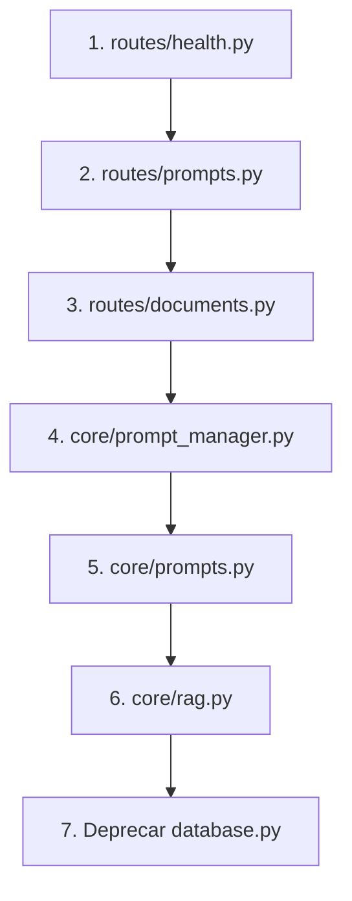

# Plano de Migração - Repository Pattern

## Objetivo
Migrar consumidores do `database.py` para usar os novos Repositories.

---

## Consumidores Identificados

| Arquivo | Funções Importadas | Prioridade |
|---------|-------------------|------------|
| `src/app.py` | `init_database`, `check_connection` | Baixa (não muda) |
| `src/api/routes/health.py` | `get_document_count`, `check_connection`, `list_collections` | Alta |
| `src/api/routes/documents.py` | CRUD de documents e ingestion | Alta |
| `src/api/routes/prompts.py` | CRUD de prompts | Alta |
| `src/core/rag.py` | `search_similar`, `get_parent_content`, `get_prompt` | Crítica |
| `src/core/prompt_manager.py` | `get_prompts_by_category`, `get_prompt` | Média |
| `src/core/prompts.py` | `get_prompt` | Média |

---

## Fases de Migração

### Fase 1: Camada de API (Baixo Risco)

#### 1.1 `routes/health.py`

```diff
- from src.data.database import get_document_count, check_connection, list_collections
+ from src.data.database import check_connection
+ from src.data.repositories import DocumentRepository

+ _doc_repo = DocumentRepository()

  def get_stats():
-     doc_count = get_document_count()
+     doc_count = _doc_repo.count()

  def get_collections():
-     collections = list_collections()
+     collections = _doc_repo.list_collections()
```

#### 1.2 `routes/prompts.py`

```diff
- from src.data.database import (
-     list_prompts, get_prompt_by_id, create_prompt,
-     update_prompt_full, delete_prompt_safe, can_delete_prompt,
-     CRITICAL_CATEGORIES
- )
+ from src.data.repositories import PromptRepository, CRITICAL_CATEGORIES

+ _prompt_repo = PromptRepository()

  def get_all_prompts():
-     prompts = list_prompts()
+     prompts = _prompt_repo.list_all()
```

#### 1.3 `routes/documents.py`

```diff
+ from src.data.repositories import DocumentRepository, IngestionRepository

+ _doc_repo = DocumentRepository()
+ _ingestion_repo = IngestionRepository()

  # Em delete_ingested_document():
-     existing = get_ingested_document(file_path)
+     existing = _ingestion_repo.find_by_path(file_path)

-     chunks_removed = remove_document_chunks_by_source(file_path)
+     chunks_removed = _doc_repo.delete_by_source(file_path)
```

---

### Fase 2: Camada Core (Risco Médio)

#### 2.1 `core/rag.py`

```diff
- from src.data.database import search_similar, get_parent_content
+ from src.data.repositories import DocumentRepository

+ _doc_repo = DocumentRepository()

  # Em search_documents():
-     results = search_similar(query_embedding, top_k, min_similarity, collection_id)
+     results = _doc_repo.find_similar(query_embedding, top_k, min_similarity, collection_id)
```

> **Nota**: `get_parent_content` precisa ser adicionado ao `DocumentRepository`.

#### 2.2 `core/prompt_manager.py` e `core/prompts.py`

```diff
- from src.data.database import get_prompts_by_category, get_prompt
+ from src.data.repositories import PromptRepository

+ _prompt_repo = PromptRepository()

  def get_prompt(name):
-     return get_prompt(name)
+     return _prompt_repo.find_by_name(name)
```

---

### Fase 3: Deprecação (Após Migração Completa)

1. Marcar funções antigas em `database.py` como `@deprecated`
2. Adicionar warnings de deprecação
3. Manter por 2-3 releases para retrocompatibilidade
4. Remover funções antigas

---

## Ordem de Execução Recomendada



---

## Verificação Após Cada Migração

```bash
# Testar health
curl http://localhost:5000/api/health
curl http://localhost:5000/api/stats

# Testar prompts
curl http://localhost:5000/api/prompts

# Testar RAG
curl -X POST http://localhost:5000/api/query -H "Content-Type: application/json" -d '{"question": "teste"}'
```

---

## Rollback

Se algo falhar:
1. Reverter apenas o arquivo migrado
2. O `database.py` original permanece funcional
3. Repositories não interferem no código existente
