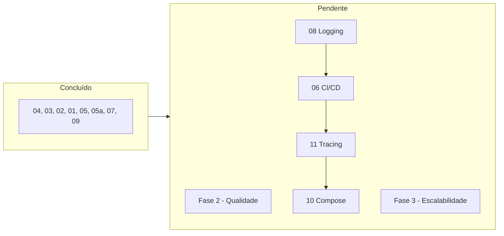

# 📋 Planos de Implementação - Revisão de Arquitetura

Este diretório contém planos detalhados para tornar o sistema RAG mais production-ready.

---

## 🟢 Fase 1: Fundação (1-2 semanas)

| # | Plano | Esforço | Impacto |
|---|-------|---------|---------|
| [01](./01_refatorar_routes_blueprints.md) | [X] Refatorar routes.py em Blueprints | Médio | Alto |
| [02](./02_dockerfile_api.md) | [X] Criar Dockerfile para API | Baixo | Alto |
| [03](./03_pinning_dependencias.md) | [X] Pinning de Dependências | Baixo | Médio |
| [04](./04_cors_restritivo.md) | [X] CORS Restritivo | Baixo | Alto |

---

## 🟡 Fase 2: Qualidade (2-3 semanas)

| # | Plano | Esforço | Impacto |
|---|-------|---------|---------|
| [05](./05_repository_pattern.md) | [X] Repository Pattern em database.py | Alto | Alto |
| [05a](./05a_migracao_repositories.md) | [X] Migração para Repositories (Camada Core) | Médio | Alto |
| [06](./06_ci_cd_github_actions.md) | Configurar CI/CD (GitHub Actions) | Médio | Alto |
| [07](./07_rate_limiting.md) | [X] Rate Limiting | Baixo | Médio |
| [08](./08_structured_logging.md) | Structured Logging (JSON) | Médio | Médio |

---

## 🔴 Fase 3: Escalabilidade (3-4 semanas)

| # | Plano | Esforço | Impacto |
|---|-------|---------|---------|
| [09](./09_refatorar_rag_services.md) | [X] Refatorar rag.py em Services | Alto | Alto |
| [10](./10_docker_compose_unificado.md) | Docker Compose Unificado | Médio | Alto |
| [11](./11_opentelemetry_tracing.md) | OpenTelemetry Tracing | Médio | Médio |

---

## 📊 Ordem de Execução Sugerida

---

## ✅ Histórico de Implementação (Ordem Cronológica)

1. **[04] CORS Restritivo** - Proteção contra origens não autorizadas.
2. **[03] Pinning de Dependências** - Estabilidade com `pip-tools`.
3. **[02] Dockerfile para API** - Base para containerização.
4. **[01] Refatoração para Blueprints** - Modularização da API.
5. **[05] Repository Pattern** - Desacoplamento da camada de dados.
6. **[05a] Migração para Repositories** - Implementação na camada Core.
7. **[07] Rate Limiting** - Proteção contra abusos.
8. **[09] Refatoração RAG Services** - Arquitetura modular SRP.

---

## 🚀 Próximos Passos (Pendentes)

1. **04 - CORS Restritivo** - menos de 1 hora, impacto alto
2. **03 - Pinning** - 30 minutos, previne bugs futuros
3. **02 - Dockerfile** - 2 horas, habilita containerização

---

> **Dica**: Cada plano é independente. Você pode implementar em qualquer ordem, mas a sequência sugerida minimiza conflitos.
